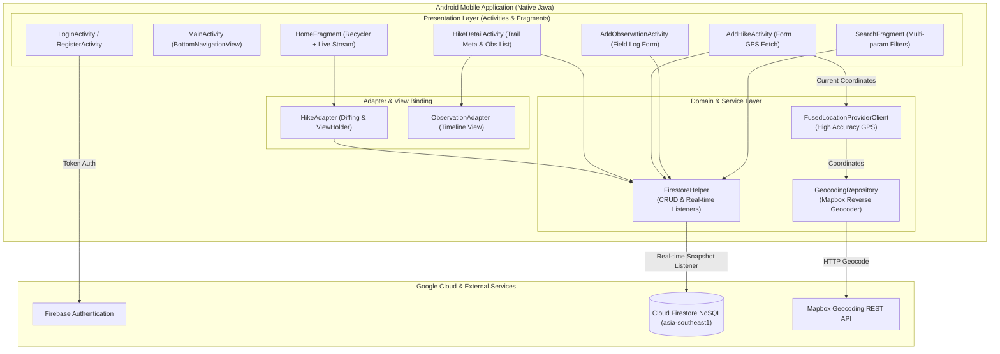

# 🌲 M-Hike — Trail Tracker & Outdoor Journal

[](https://developer.android.com)
[](https://openjdk.org/)
[](https://firebase.google.com/docs/firestore)
[](https://firebase.google.com/docs/auth)
[](https://developers.google.com/android/reference/com/google/android/gms/location/FusedLocationProviderClient)
[](https://m3.material.io)
[](LICENSE)

> **Cloud-Connected Native Android Mobile Application for Trail Planning, Waypoint Logging & Environmental Field Observations.**  
> Built for outdoor enthusiasts, expedition leaders, and environmental researchers to record hiking expeditions, capture live GPS coordinates, maintain timestamped field notes, and synchronize data instantaneously across devices using Google Cloud Firestore.

---

## 📋 Table of Contents
- [Overview & Value Proposition](#-overview--value-proposition)
- [Key Architectural Capabilities](#-key-architectural-capabilities)
- [System Architecture Diagram](#-system-architecture-diagram)
- [Data Modeling & Relationships](#-data-modeling--relationships)
- [Application Flow & Core Modules](#-application-flow--core-modules)
- [Tech Stack & Dependencies](#-tech-stack--dependencies)
- [Project Directory Structure](#-project-directory-structure)
- [Getting Started & Build Instructions](#-getting-started--build-instructions)
  - [Prerequisites](#prerequisites)
  - [Environment & Firebase Setup](#environment--firebase-setup)
  - [Building and Running in Android Studio](#building-and-running-in-android-studio)
- [Security & Permission Architecture](#-security--permission-architecture)
- [Engineering Principles](#-engineering-principles)

---

## 🧭 Overview & Value Proposition

Outdoor trail navigation and field logging often suffer from fragmented tools, poor network synchronization, and clunky input workflows. **M-Hike** resolves these challenges by combining a native, lightweight Android user experience with a scalable, reactive cloud persistence layer:

1. **Expedition Lifecycle Management:** Plan hikes with full attribute profiling (difficulty, length, expected weather conditions, destination geo-coordinates).
2. **Real-Time Data Streaming:** Leverages Firebase Cloud Firestore's continuous snapshot streams (`addSnapshotListener`) to guarantee that updates made anywhere reflect immediately on the device UI without polling or manual refreshes.
3. **Sub-ledger Field Observations:** Log granular field discoveries (wildlife sightings, trail obstacles, water point locations) strictly bound to specific parent expeditions via foreign key indexing.
4. **GPS Location Service Integration:** Automatically captures high-precision coordinates using Google Play Services `FusedLocationProviderClient` and resolves human-readable names via reverse geocoding.

---

## ⚡ Key Architectural Capabilities

- **Reactive Cloud Synchronization:** Subscribes to document change events using Firestore real-time listeners. Any remote insertion or modification updates the local `RecyclerView` dynamically.
- **Identity & Session Management:** Integrated with Firebase Authentication (Email/Password registration, session persistence, and self-service password reset flows).
- **Relational Integrity on NoSQL:** Enforces clean parent-child relationship modeling between the `hikes` collection and the `observations` sub-collection.
- **High-Precision Geolocation:** Supports `ACCESS_FINE_LOCATION` with fallback to `ACCESS_COARSE_LOCATION` and automated permission negotiation.
- **Defensive Input Validation:** Enforces strict client-side validation on mandatory fields (trail name, location, dates, length, difficulty levels) preventing corrupt records.
- **Graceful Empty State & Seeding:** Automatically provisions starter expedition entries when collections are initialized, ensuring instantaneous onboarding.

---

## 🏗️ System Architecture Diagram



---

## 🗄️ Data Modeling & Relationships

Cloud Firestore organizes data into two primary collections with foreign-key referential integrity:

### 1. `hikes` Collection
Represents individual outdoor hiking expeditions and their top-level operational parameters:

| Field | Type | Constraint | Description |
| :--- | :--- | :--- | :--- |
| `name` | String | Required | Trail name / expedition title |
| `location` | String | Required | Geo-destination or trail landmark |
| `date` | String | Format `dd/MM/yyyy` | Scheduled or completed expedition date |
| `difficulty` | String | Enum (`Easy`, `Medium`, `Hard`) | Physical demand level of the hike |
| `length` | String | Required | Total trail distance in kilometers |
| `weather` | String | Optional | Recorded weather conditions |
| `imageResName` | String | Asset Identifier | Drawable resource name (`img1` to `img5`) |
| `firebaseId` | String | Primary Key | Generated document identifier |

### 2. `observations` Collection
Granular observations and field discoveries logged during an ongoing or completed hike:

| Field | Type | Constraint | Description |
| :--- | :--- | :--- | :--- |
| `observation` | String | Required | Summary of environmental or trail observation |
| `time` | String | Format `HH:mm` | Timestamp of recorded sighting |
| `comments` | String | Optional | Extended notes, wildlife tags, or safety remarks |
| `hikeFirebaseId`| String | **Foreign Key** | References parent `hikes.firebaseId` |

---

## 📱 Application Flow & Core Modules

```
                    ┌─────────────────┐
                    │  LoginActivity  │
                    └────────┬────────┘
                             │ (Authenticated)
                             ▼
                    ┌─────────────────┐
                    │  MainActivity   │
                    └────────┬────────┘
         ┌───────────────────┼───────────────────┐
         ▼                   ▼                   ▼
  ┌──────────────┐   ┌──────────────┐   ┌──────────────┐
  │ HomeFragment │   │ SearchFrag   │   │ ProfileFrag  │
  └──────┬───────┘   └──────────────┘   └──────────────┘
         │
         ├─── Click Hike ──────► ┌──────────────────────┐
         │                       │  HikeDetailActivity  │
         │                       └──────────┬───────────┘
         │                                  │
         │                                  ▼
         │                       ┌──────────────────────┐
         │                       │AddObservationActivity│
         │                       └──────────────────────┘
         │
         └─── FAB (+) ─────────► ┌──────────────────────┐
                                 │   AddHikeActivity    │
                                 │   (GPS Auto-Fill)    │
                                 └──────────────────────┘
```

---

## 🛠️ Tech Stack & Dependencies

- **Platform:** Android SDK (minSdkVersion 26, targetSdkVersion 34, compileSdk 34)
- **Language:** Java 17
- **Cloud Infrastructure:**
  - `com.google.firebase:firebase-firestore:25.1.0` (Cloud document storage)
  - `com.google.firebase:firebase-auth:23.0.0` (User authorization)
  - `com.google.firebase:firebase-bom:33.1.2` (BOM dependency alignment)
- **Geolocation & Mapping:**
  - `com.google.android.gms:play-services-location:21.3.0` (Fused Location Provider)
  - `com.squareup.retrofit2:retrofit:2.11.0` & `converter-gson:2.11.0` (Geocoding HTTP client)
- **UI & Layout:**
  - `com.google.android.material:material:1.12.0` (Material 3 components)
  - `androidx.recyclerview:recyclerview:1.3.2` (Virtualized list rendering)
  - `androidx.cardview:cardview:1.0.0`

---

## 📁 Project Directory Structure

```
mhike-android-trail-tracker/
├── app/
│   ├── src/
│   │   ├── main/
│   │   │   ├── java/com/example/hiking_application_coursework/
│   │   │   │   ├── activities/
│   │   │   │   │   ├── MainActivity.java           # Bottom navigation host
│   │   │   │   │   ├── LoginActivity.java          # Authentication controller
│   │   │   │   │   ├── RegisterActivity.java       # User onboarding
│   │   │   │   │   ├── AddHikeActivity.java        # Hike creation & GPS form
│   │   │   │   │   ├── HikeDetailActivity.java     # Detailed view & sub-notes
│   │   │   │   │   └── AddObservationActivity.java # Field note creation
│   │   │   │   ├── fragments/
│   │   │   │   │   ├── HomeFragment.java           # Live stream of active hikes
│   │   │   │   │   ├── SearchFragment.java         # Dynamic keyword/filter search
│   │   │   │   │   ├── MapFragment.java            # Geo-coordinate preview
│   │   │   │   │   └── ProfileFragment.java        # User profile & sign-out
│   │   │   │   ├── adapters/
│   │   │   │   │   ├── HikeAdapter.java            # RecyclerView adapter for hikes
│   │   │   │   │   └── ObservationAdapter.java     # RecyclerView adapter for notes
│   │   │   │   ├── helpers/
│   │   │   │   │   └── FirestoreHelper.java        # Centralized Firestore CRUD gateway
│   │   │   │   ├── api/                            # Retrofit geocoding service layer
│   │   │   │   └── models/                         # POJO entity definitions
│   │   │   ├── res/
│   │   │   │   ├── layout/                         # XML declarative UI layouts
│   │   │   │   ├── drawable/                       # Vector assets & trail mock photos
│   │   │   │   └── values/                         # Colors, themes, typography
│   │   │   └── AndroidManifest.xml                 # App manifest & permissions
│   │   └── test/                                   # Unit & API mock tests
│   ├── build.gradle.kts                            # App module build configuration
│   └── google-services.json                        # Firebase configuration asset
├── docs/                                           # Architecture & technical references
│   ├── gps_location_and_maps.md                    # Deep-dive on GPS & Geocoding
│   ├── source_code_and_database.md                 # Database query patterns & methods
│   ├── ui_ux_design_and_interactions.md            # Interaction guidelines & wireframes
│   └── workflow_and_project_structure.md           # Engineering patterns & life-cycles
├── .gitignore                                      # Comprehensive Android/IntelliJ hygiene
├── build.gradle.kts                                # Root project build script
└── README.md                                       # Project documentation
```

---

## 🚀 Getting Started & Build Instructions

### Prerequisites
- **Android Studio:** Hedgehog (2023.1.1) or newer ([Download](https://developer.android.com/studio))
- **JDK:** OpenJDK 17 LTS
- **Android SDK:** API Level 34 installed via SDK Manager
- An Android Virtual Device (AVD) running API 26+ or a physical Android test device with USB debugging enabled.

---

### Environment & Firebase Setup

1. **Clone the repository:**
   ```bash
   git clone https://github.com/DucNgVan/mhike-android-trail-tracker.git
   cd mhike-android-trail-tracker
   ```

2. **Verify Firebase Credentials:**
   Ensure `app/google-services.json` is located in the `app/` directory with a valid Google Cloud project identifier.

3. **Firebase Security Rules:**
   For development environments, enable Firestore read/write permissions in the Firebase Console:
   ```javascript
   rules_version = '2';
   service cloud.firestore {
     match /databases/{database}/documents {
       match /{document=**} {
         allow read, write: if request.auth != null;
       }
     }
   }
   ```

---

### Building and Running in Android Studio

1. Open Android Studio, select **Open**, and navigate to the cloned project root.
2. Wait for Gradle Sync to complete (`Sync Project with Gradle Files`).
3. Select your target device/emulator in the device toolbar.
4. Click **Run 'app'** (`Shift + F10`) or execute from CLI:
   ```bash
   # On macOS/Linux:
   ./gradlew assembleDebug

   # On Windows PowerShell:
   .\gradlew.bat assembleDebug
   ```
5. The generated APK will be compiled into `app/build/outputs/apk/debug/app-debug.apk`.

---

## 🔒 Security & Permission Architecture

- **Runtime Permission Negotiation:** Requests `ACCESS_FINE_LOCATION` and `ACCESS_COARSE_LOCATION` dynamically at runtime before accessing sensor data.
- **Credential Protection:** Cloud API secrets and token strings are kept out of revision control. Duplicate credential artifacts and user-specific IDE caches are excluded via `.gitignore`.
- **Encapsulated Data Access:** UI layers never invoke raw Firestore calls directly; all operations route through `FirestoreHelper.java` to maintain uniform exception logging and data status contracts.

---

## 📄 License

This project is licensed under the [MIT License](LICENSE) — free for use in portfolio presentations, personal learning, and open-source contributions.
