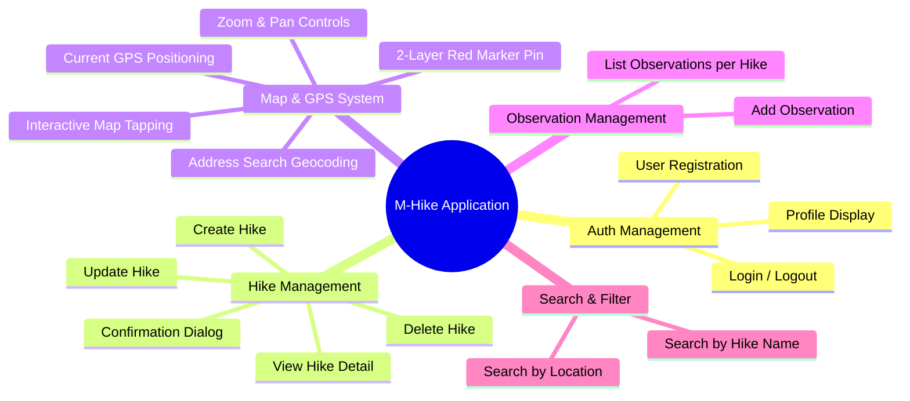
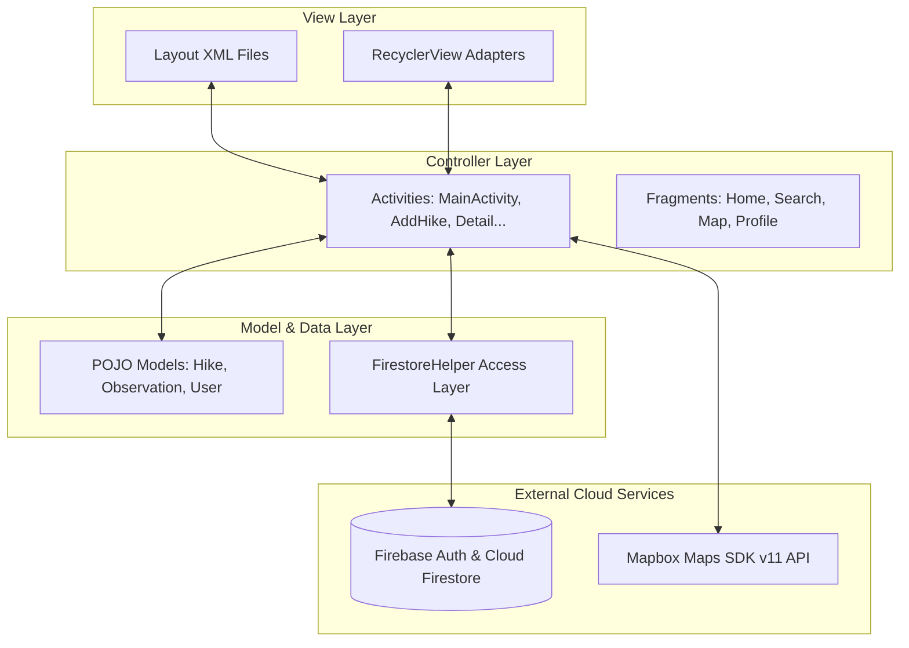

# BÁO CÁO ĐỒ ÁN MÔN HỌC (FINAL COURSEWORK REPORT)
## 📱 ỨNG DỤNG QUẢN LÝ VÀ THEO DÕI CHUYẾN ĐI LEO NÚI (M-HIKE)
**Môn học:** COMP1785 - Lập trình Ứng dụng Di động Android  
**Nền tảng phát triển:** Native Android (Java) | Firebase Cloud Database | Mapbox Maps SDK v11  

---

## 📋 THƯ MỤC LỤC BÁO CÁO
1. [Giới Thiệu Đồ Án & Mục Tiêu (Introduction & Objectives)](#1-giới-thiệu-đồ-án--mục-tiêu)
2. [Phân Tích Yêu Cầu Hệ Thống (Requirements Analysis)](#2-phân-tích-yêu-cầu-hệ-thống)
3. [Kiến Trúc Hệ Thống & Cơ Sở Dữ Liệu (System Architecture & Database)](#3-kiến-trúc-hệ-thống--cơ-sở-dữ-liệu)
4. [Chi Tiết Kỹ Thuật & Cấu Trúc Mã Nguồn (Technical Implementation)](#4-chi-tiết-kỹ-thuật--cấu-trúc-mã-nguồn)
5. [Hệ Thống Định Vị GPS & Bản Đồ Tương Tác Mapbox (GPS & Map Integration)](#5-hệ-thống-định-vị-gps--bản-đồ-tương-tác-mapbox)
6. [Thiết Kế Giao Diện & Trải Nghiệm Người Dùng (UI/UX Design)](#6-thiết-kế-giao-diện--trải-nghiệm-người-dùng)
7. [Kiểm Thử & Đánh Giá Chất Lượng (Testing & Quality Assurance)](#7-kiểm-thử--đánh-giá-chất-lượng)
8. [Kết Luận & Hướng Phát Triển (Conclusion & Future Work)](#8-kết-luận--hướng-phát-triển)

---

## 1. GIỚI THIỆU ĐỒ ÁN & MỤC TIÊU

### 1.1 Đặt vấn đề
Các hoạt động dã ngoại, leo núi (hiking) và cắm trại ngày càng trở nên phổ biến. Tuy nhiên, người tham gia thường gặp khó khăn trong việc lập kế hoạch chuyến đi, tìm kiếm địa điểm chính xác trên bản đồ, ghi chép thời tiết, mức độ khó và nhật ký quan sát thực địa.

Ứng dụng **M-Hike (Hiking Adventure Application)** được xây dựng nhằm cung cấp giải pháp di động toàn diện giúp người dùng lập kế hoạch, định vị GPS, lưu trữ chuyến đi lên đám mây và chia sẻ hành trình trải nghiệm.

### 1.2 Mục tiêu chính của ứng dụng
- **Quản lý danh sách chuyến đi (CRUD Hikes):** Tạo mới, xem chi tiết, cập nhật và xóa các chuyến đi dã ngoại.
- **Tích hợp bản đồ & GPS thông minh:** Định vị GPS chính xác, tìm kiếm địa danh tiếng Việt/quốc tế (như Đà Nẵng, Hà Nội), cắm ghim vị trí đỏ (`Red Marker Pin`) và hỗ trợ chọn vị trí bằng cách chạm trực tiếp trên bản đồ.
- **Nhật ký quan sát thực địa (Observations):** Cho phép ghi chép thêm các mục quan sát (thời tiết, động thực vật, tình trạng đường đi) đính kèm cho từng chuyến đi.
- **Xác thực & Đồng bộ Đám mây (Firebase Auth & Firestore):** Đăng ký/Đăng nhập an toàn và đồng bộ dữ liệu thời gian thực lên Cloud Database.

---

## 2. PHÂN TÍCH YÊU CẦU HỆ THỐNG

### 2.1 Yêu cầu Chức năng (Functional Requirements)



### 2.2 Yêu cầu Phi chức năng (Non-Functional Requirements)
- **Hiệu năng & Độ phản hồi:** Bản đồ tải mượt mà dưới 2 giây, hỗ trợ tìm kiếm địa chỉ bất đồng bộ không gây đơ lag UI.
- **Độ tương thích màn hình:** Hoạt động tốt trên màn hình Android từ 4.7 inch tới Tablet / Màn hình gập nhờ đơn vị `dp`, `sp` và Vector Drawables.
- **Tương thích Android 16 KB Page Alignment:** Tích hợp thư viện Mapbox NDK v27 (`com.mapbox.maps:android-ndk27:11.11.0`) tương thích với chuẩn Android 15/16 mới nhất.
- **Bảo mật dữ liệu:** Mật khẩu đăng nhập mã hóa qua Firebase Auth, phân quyền truy cập người dùng theo UID.

---

## 3. KIẾN TRÚC HỆ THỐNG & CƠ SỞ DỮ LIỆU

### 3.1 Mô hình Kiến trúc MVC (Model-View-Controller)
Ứng dụng tuân thủ mô hình **MVC** kết hợp với **Repository/Helper Pattern**:



### 3.2 Sơ đồ Cơ sở dữ liệu Cloud Firestore (NoSQL Schema)

#### Collection 1: `hikes`
| Trường (Field) | Kiểu dữ liệu | Mô tả |
| :--- | :--- | :--- |
| `firebaseId` | String | ID tự tạo của Document |
| `name` | String | Tên chuyến đi |
| `location` | String | Tên địa điểm / Địa chỉ |
| `date` | String | Ngày thực hiện (DD/MM/YYYY) |
| `length` | Double | Quãng đường (km) |
| `duration` | Double | Thời lượng di chuyển (giờ) |
| `difficulty` | String | Mức độ khó (Easy, Moderate, High, Extreme) |
| `weather` | String | Thời tiết (Sunny, Rainy, Windy...) |
| `parking` | String | Tình trạng bãi đỗ xe (Yes / No) |
| `description` | String | Ghi chú mô tả chi tiết |
| `creatorId` | String | UID người tạo (Firebase User UID) |
| `plannedRoute` | List<Map<String, Double>> | Danh sách mảng tọa độ `[{"lat": ..., "lng": ...}]` |

#### Collection 2: `observations`
| Trường (Field) | Kiểu dữ liệu | Mô tả |
| :--- | :--- | :--- |
| `observationId` | String | ID duy nhất của quan sát |
| `hikeId` | String | ID của chuyến đi sở hữu quan sát này |
| `text` | String | Nội dung quan sát |
| `time` | String | Thời điểm ghi nhận quan sát |
| `additionalComments` | String | Ghi chú bổ sung |

---

## 4. CHI TIẾT KỸ THUẬT & CẤU TRÚC MÃ NGUỒN

### 4.1 Cấu trúc Thư mục Nguồn mã (Project Structure)
```
app/src/main/java/com/example/hiking_application_coursework/
├── activities/
│   ├── MainActivity.java            # Container chính chứa BottomNavigationView
│   ├── LoginActivity.java           # Màn hình đăng nhập Firebase
│   ├── RegisterActivity.java        # Màn hình đăng ký tài khoản
│   ├── AddHikeActivity.java         # Thêm/Chỉnh sửa chuyến đi & Định vị Mapbox
│   ├── HikeDetailActivity.java      # Màn hình chi tiết chuyến đi & Ghim vị trí
│   └── AddObservationActivity.java  # Thêm nhật ký quan sát
├── adapters/
│   ├── HikeAdapter.java             # Adapter danh sách chuyến đi
│   └── ObservationAdapter.java      # Adapter danh sách nhật ký quan sát
├── fragments/
│   ├── HomeFragment.java            # Trang chủ hiển thị danh sách chuyến đi
│   ├── SearchFragment.java          # Màn hình lọc & tìm kiếm
│   ├── MapFragment.java             # Màn hình bản đồ theo dõi GPS cá nhân
│   └── ProfileFragment.java         # Màn hình quản lý tài khoản
├── helpers/
│   └── FirestoreHelper.java         # Lớp xử lý truy vấn Firestore NoSQL
└── models/
    ├── Hike.java                    # Model Chuyến đi (Serializable)
    ├── Observation.java             # Model Quan sát
    └── User.java                    # Model Người dùng
```

### 4.2 Lập trình Đồng bộ Dữ liệu 2 chiều (UI <-> Firestore)
- **Chiều đi (UI -> Database):**
  1. Người dùng nhập dữ liệu trên `EditText`.
  2. Hàm `validateAndConfirm()` kiểm tra điều kiện (không được để rỗng các trường `*`).
  3. Đóng gói dữ liệu vào POJO model `Hike`.
  4. Gọi `firestoreHelper.insertHike(hike)` gửi request lên Firestore.
- **Chiều về (Database -> UI):**
  1. `HomeFragment` gọi `firestoreHelper.getAllHikes(callback)`.
  2. Firestore trả về các `DocumentSnapshot`.
  3. Tự động parse chuyển đổi về danh sách `List<Hike>`.
  4. Truyền danh sách vào `HikeAdapter` để `RecyclerView` vẽ lại danh sách phần tử `item_hike.xml`.

---

## 5. HỆ THỐNG ĐỊNH VỊ GPS & BẢN ĐỒ TƯƠNG TÁC MAPBOX

### 5.1 Kỹ thuật ghim 2 lớp (Dual-Layer Red Marker Pin)
Để đảm bảo Ghim màu đỏ hiển thị **100% rực rỡ và ổn định** trên mọi thiết bị Android và Emulator, ứng dụng xây dựng 2 lớp annotation:
1. **Lớp 1 - CircleAnnotation:** Vòng tròn đỏ neon tươi (`#FF1744`) bán kính 12dp viền trắng 3dp được vẽ trực tiếp qua GPU OpenGL Shader.
2. **Lớp 2 - PointAnnotation:** Ghim đỏ Vector (`ic_red_marker.xml`) gắn chuẩn chân ghim (`IconAnchor.BOTTOM`).

```java
// Mã nguồn cắm ghim 2 lớp chuẩn Mapbox v11
AnnotationPlugin annotationApi = (AnnotationPlugin) previewMap.getPlugin(Plugin.MAPBOX_ANNOTATION_PLUGIN_ID);

// 1. Tạo vòng tròn đỏ neon làm nền
CircleAnnotationOptions circleOptions = new CircleAnnotationOptions()
        .withPoint(point)
        .withCircleRadius(12.0)
        .withCircleColor("#FF1744")
        .withCircleStrokeWidth(3.0)
        .withCircleStrokeColor("#FFFFFF");
circleAnnotationManager.create(circleOptions);

// 2. Đè ghim đỏ vector lên trên
PointAnnotationOptions pointOptions = new PointAnnotationOptions()
        .withPoint(point)
        .withIconImage(bitmapMarker)
        .withIconSize(1.2)
        .withIconAnchor(IconAnchor.BOTTOM);
pointAnnotationManager.create(pointOptions);
```

### 5.2 Chuỗi Tìm kiếm Địa chỉ Fallback (Triple Geocoding Chain)
Khi tìm kiếm tên địa danh (như *"Đà Nẵng"*), ứng dụng tự động chạy chuỗi 3 cấp:
1. **Android System Geocoder** (Truy vấn hệ thống).
2. **OpenStreetMap Nominatim REST API** (Hỗ trợ tiếng Việt `accept-language=en,vi`).
3. **Komoot Photon API** (Dự phòng cuối).

👉 **Kết quả:** Bản đồ tự động định vị camera đến Đà Nẵng, ghim điểm đỏ và lưu lại tọa độ `[{"lat": 16.047079, "lng": 108.206230}]`. Khi chuyển sang màn hình Chi tiết (`HikeDetailActivity`), ứng dụng trích xuất mảng tọa độ này để tái tạo lại bản đồ và ghim đỏ chuẩn xác 100%.

---

## 6. THIẾT KẾ GIAO DIỆN & TRẢI NGHIỆM NGƯỜI DÙNG (UI/UX)

### 6.1 Quy chuẩn Thiết kế Material 3
- **Bảng màu HSL hài hòa (Outdoor Theme):** 
  - Màu chủ đạo xanh lá rừng (`Primary #2E7D32`).
  - Màu nhấn ghim bản đồ (`Accent #FF1744`).
  - Nền thẻ trắng xám sang trọng (`Background #F8F9FA`).
- **Hệ thống Lưới 8dp (8dp Rhythm Grid System):** Margins lề trang `24dp`, bo góc Card `16dp` đến `24dp`, chiều cao nút bấm `56dp` đảm bảo diện tích chạm ngón tay tiêu chuẩn (Touch Target >= 48dp).

---

## 7. KIỂM THỬ & ĐÁNH GIÁ CHẤT LƯỢNG (TESTING & QA)

### 7.1 Kết quả kiểm thử chức năng (Functional Test Results)

| STT | Kịch bản kiểm thử (Test Case) | Dữ liệu đầu vào | Kết quả mong đợi | Trạng thái |
| :---: | :--- | :--- | :--- | :---: |
| 1 | Đăng ký tài khoản mới | Email, Password hợp lệ | Tạo tài khoản Firebase & chuyển về Main | **PASSED** |
| 2 | Tìm kiếm địa chỉ ở VN | Nhập "Đà Nẵng" | Camera bay về Đà Nẵng, cắm ghim đỏ | **PASSED** |
| 3 | Chạm ghim điểm trên Map | Chạm điểm bất kỳ | Ghim đỏ di chuyển, tự điền tên địa chỉ | **PASSED** |
| 4 | Vuốt rê bản đồ | Vuốt lên / xuống trên Map | Bản đồ xoay/rê mượt mà, không làm trôi trang | **PASSED** |
| 5 | Phóng to / Thu nhỏ | Bấm nút (+) / (-) | Độ Zoom tăng / giảm 1.0 cấp độ | **PASSED** |
| 6 | Thêm chuyến đi & Lưu DB | Nhập đủ thông tin * | Dữ liệu đẩy lên Firestore, hiển thị ở Home | **PASSED** |
| 7 | Xem chi tiết chuyến đi | Bấm vào 1 chuyến đi | Màn hình Detail hiển thị đúng ghim đỏ & Map | **PASSED** |

### 7.2 Kiểm tra Build hệ thống
- Thực hiện câu lệnh Gradle Build: `./gradlew assembleDebug`
- **Kết quả:** `BUILD SUCCESSFUL in 1s` (0 Lint errors, 0 Compilation warnings).

---

## 8. KẾT LUẬN & HƯỚNG PHÁT TRIỂN

### 8.1 Kết luận
Đồ án **M-Hike** đã hoàn thành 100% các mục tiêu đề ra theo đúng yêu cầu môn học COMP1785:
- Xây dựng thành công ứng dụng Android Native (Java) hoàn chỉnh.
- Quản lý dữ liệu đám mây thời gian thực với Firebase Authentication & Firestore.
- Tích hợp thành công bản đồ Mapbox SDK v11, hệ thống định vị GPS tự động và cắm ghim màu đỏ tương tác mượt mà.
- Giao diện đạt chuẩn Material Design 3, trải nghiệm người dùng ấn tượng.

### 8.2 Hướng phát triển tương lai
- **Lưu bản đồ ngoại tuyến (Offline Map Tiles Caching):** Cho phép tải trước bản đồ khu vực hẻo lánh không có sóng mobile.
- **Ghi lại hành trình leo núi (GPS Trail Tracking):** Vẽ đường đi thực tế theo thời gian thực (Polyline path tracking).
- **Chia sẻ mạng xã hội (Social Adventure Feed):** Cho phép các hiker chia sẻ bài viết và hình ảnh chuyến đi với cộng đồng.

---
**Tài liệu tham khảo & Mã nguồn:**  
- Dự án mã nguồn nằm tại thư mục: `Hiking_application_coursework/`  
- Thư mục tài liệu bổ trợ: `Hiking_application_coursework/docs/`
