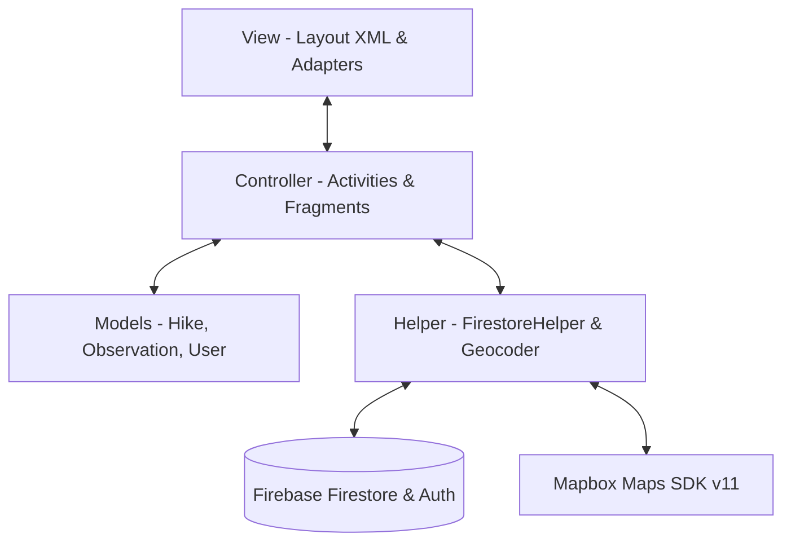
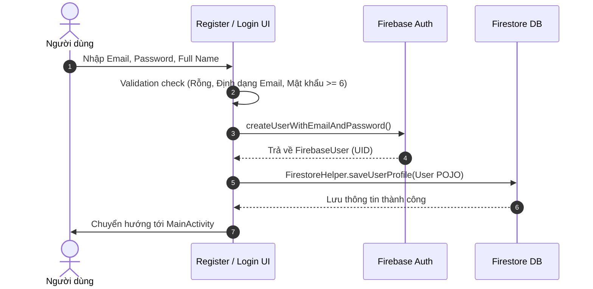
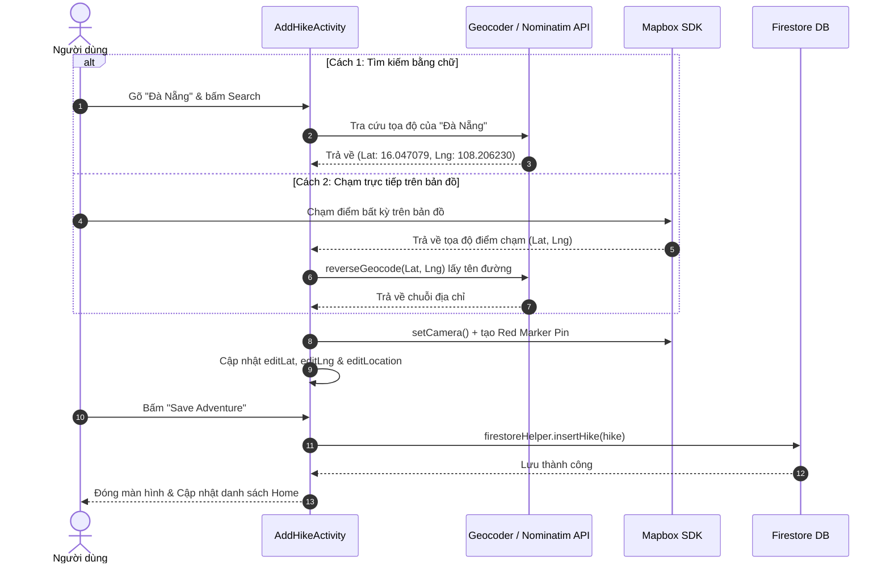

# TÀI LIỆU WORKFLOW & CẤU TRÚC DỰ ÁN (PROJECT STRUCTURE & WORKFLOW)

## 1. MÔ HÌNH KIẾN TRÚC VÀ CẤU TRÚC THƯ MỤC

### 1.1 Mô hình kiến trúc ứng dụng
Dự án được xây dựng theo mô hình kiến trúc **MVC (Model - View - Controller)** kết hợp với **Helper / Repository Pattern** để quản lý dữ liệu bất đồng bộ từ Cloud Firestore.

- **Model (Mô hình dữ liệu):** Đại diện cho các đối tượng dữ liệu trong ứng dụng như `Hike`, `Observation`, `User`. Được đặt trong gói `com.example.hiking_application_coursework.models`.
- **View (Giao diện người dùng):** Các tệp giao diện XML trong `res/layout/` chịu trách nhiệm định hình giao diện người dùng (UX/UI).
- **Controller (Bộ điều khiển):** Các `Activity` và `Fragment` nằm trong gói `activities` và `fragments`. Chúng tiếp nhận tương tác của người dùng, thực hiện kiểm tra dữ liệu (validation) và điều khiển giao diện.
- **Helper / Data Access Layer:** `FirestoreHelper` chịu trách nhiệm kết nối trực tiếp tới Firebase Firestore, thực hiện các thao tác CRUD và trả kết quả về Controller qua Callback Interface (`DataStatus`, `ObservationStatus`).



---

### 1.2 Tổ chức thư mục hiện tại (Directory Structure)

```
app/src/main/java/com/example/hiking_application_coursework/
├── activities/                      # Gói chứa các màn hình Activity chính
│   ├── MainActivity.java            # Container chứa BottomNavigationView & FragmentManager
│   ├── LoginActivity.java           # Đăng nhập tài khoản Firebase Auth
│   ├── RegisterActivity.java        # Đăng ký tài khoản mới & lưu Profile vào Firestore
│   ├── AddHikeActivity.java         # Thêm / Chỉnh sửa chuyến đi & Định vị / Bản đồ Mapbox
│   ├── HikeDetailActivity.java      # Xem chi tiết chuyến đi, bản đồ ghim & danh sách quan sát
│   └── AddObservationActivity.java  # Thêm quan sát (Observation) cho chuyến đi
├── adapters/                        # Gói chứa các RecyclerView Adapter
│   ├── HikeAdapter.java             # Hiển thị danh sách các chuyền đi (Hike List)
│   └── ObservationAdapter.java      # Hiển thị danh sách các quan sát (Observation List)
├── fragments/                       # Gói chứa các màn hình Tab chính (Fragment)
│   ├── HomeFragment.java            # Trang chủ: Danh sách chuyến đi cá nhân & cộng đồng
│   ├── SearchFragment.java          # Màn hình tìm kiếm chuyến đi theo tên / vị trí
│   ├── MapFragment.java             # Màn hình bản đồ theo dõi GPS hiện tại người dùng
│   └── ProfileFragment.java         # Trang cá nhân: Thông tin người dùng & Đăng xuất
├── helpers/                         # Gói chứa các lớp hỗ trợ kết nối dữ liệu
│   └── FirestoreHelper.java         # Wrapper thao tác với Firebase Firestore Database
└── models/                          # Gói chứa các lớp Data Model POJO
    ├── Hike.java                    # Định nghĩa đối tượng Chuyến đi
    ├── Observation.java             # Định nghĩa đối tượng Quan sát
    └── User.java                    # Định nghĩa đối tượng Người dùng
```

---

## 2. GIẢI THÍCH CHI TIẾT TẤT CẢ FILE VÀ HÀM TRONG NGUỒN MÃ

### 2.1 Gói Model (`models/`)

#### 1. [`Hike.java`](file:///Users/3o/Documents/Study/Semescher%207/COMP1785_Androi_studio/Hiking_application_coursework/app/src/main/java/com/example/hiking_application_coursework/models/Hike.java)
- **Mục đích:** Khai báo cấu trúc đối tượng Chuyến đi (Hike) lưu trên Firestore và truyền qua `Intent` giữa các Activity (triển khai `Serializable`).
- **Các thuộc tính chính:**
  - `firebaseId`: Mã ID duy nhất của document trên Firestore.
  - `name`: Tên chuyến đi (bắt buộc).
  - `location`: Tên địa điểm / địa chỉ (bắt buộc).
  - `date`: Ngày thực hiện chuyến đi.
  - `length`: Độ dài quãng đường (km).
  - `duration`: Thời lượng di chuyển (giờ).
  - `difficulty`: Mức độ khó (Easy, Moderate, High, Extreme).
  - `weather`: Tình trạng thời tiết.
  - `parking`: Tình trạng bãi đỗ xe (Yes / No).
  - `description`: Mô tả chi tiết.
  - `creatorId`: UID của người tạo chuyến đi.
  - `creatorName`: Tên hiển thị người tạo.
  - `imageResName`: Tên tệp ảnh đại diện chuyến đi (`img1` -> `img5`).
  - `plannedRoute` & `routePoints`: Danh sách tọa độ `[{"lat": double, "lng": double}]` ghim trên bản đồ.

#### 2. [`Observation.java`](file:///Users/3o/Documents/Study/Semescher%207/COMP1785_Androi_studio/Hiking_application_coursework/app/src/main/java/com/example/hiking_application_coursework/models/Observation.java)
- **Mục đích:** Lưu thông tin các mục quan sát được ghi lại trong suốt chuyến đi.
- **Các thuộc tính chính:**
  - `observationId`: Mã ID của quan sát.
  - `hikeId`: Mã chuyến đi chứa quan sát này.
  - `text`: Nội dung ghi chú quan sát.
  - `time`: Thời gian ghi nhận.
  - `additionalComments`: Bổ sung ghi chú.

#### 3. [`User.java`](file:///Users/3o/Documents/Study/Semescher%207/COMP1785_Androi_studio/Hiking_application_coursework/app/src/main/java/com/example/hiking_application_coursework/models/User.java)
- **Mục đích:** Lưu trữ hồ sơ thông tin người dùng trong collection `users` trên Firestore.
- **Các thuộc tính chính:** `uid`, `email`, `fullName`, `createdAt`.

---

### 2.2 Gói Activity (`activities/`)

#### 1. [`MainActivity.java`](file:///Users/3o/Documents/Study/Semescher%207/COMP1785_Androi_studio/Hiking_application_coursework/app/src/main/java/com/example/hiking_application_coursework/activities/MainActivity.java)
- **Mục đích:** Màn hình gốc chứa Bottom Navigation Bar điều hướng giữa 4 Fragment.
- **Hàm chính:**
  - `onCreate()`: Kiểm tra trạng thái đăng nhập (`FirebaseAuth.getCurrentUser()`). Nếu chưa đăng nhập thì chuyển hướng sang `LoginActivity`. Nếu đã đăng nhập thì khởi tạo `BottomNavigationView` và load `HomeFragment` mặc định.
  - `loadFragment(Fragment fragment)`: Thay thế Fragment hiện tại vào `FrameLayout` bằng `getSupportFragmentManager().beginTransaction().replace(...)`.

#### 2. [`LoginActivity.java`](file:///Users/3o/Documents/Study/Semescher%207/COMP1785_Androi_studio/Hiking_application_coursework/app/src/main/java/com/example/hiking_application_coursework/activities/LoginActivity.java)
- **Mục đích:** Xử lý đăng nhập tài khoản người dùng bằng Email & Mật khẩu.
- **Hàm chính:**
  - `performLogin()`: Đọc `editEmail` và `editPassword`, kiểm tra hợp lệ và gọi `mAuth.signInWithEmailAndPassword(email, password)`.
  - `onSuccess / onFailure`: Nếu thành công, chuyển hướng đến `MainActivity`. Nếu thất bại, hiển thị thông báo `Toast`.

#### 3. [`RegisterActivity.java`](file:///Users/3o/Documents/Study/Semescher%207/COMP1785_Androi_studio/Hiking_application_coursework/app/src/main/java/com/example/hiking_application_coursework/activities/RegisterActivity.java)
- **Mục đích:** Đăng ký tài khoản mới và tạo hồ sơ người dùng trong Firestore.
- **Hàm chính:**
  - `performRegister()`: Kiểm tra hợp lệ (Email đúng định dạng, mật khẩu >= 6 ký tự), gọi `mAuth.createUserWithEmailAndPassword()`. Khi tạo tài khoản Firebase thành công, cập nhật `UserProfileChangeRequest` và tạo document người dùng trong `FirestoreHelper.saveUserProfile()`.

#### 4. [`AddHikeActivity.java`](file:///Users/3o/Documents/Study/Semescher%207/COMP1785_Androi_studio/Hiking_application_coursework/app/src/main/java/com/example/hiking_application_coursework/activities/AddHikeActivity.java)
- **Mục đích:** Màn hình thêm mới hoặc chỉnh sửa chuyến đi (bao gồm định vị GPS & Bản đồ Mapbox).
- **Hàm chính:**
  - `setupUI()`: Khởi tạo các view, gán Adapter cho Spinner, lắng nghe thay đổi tọa độ `editLat`/`editLng` qua `TextWatcher` và gán sự kiện tìm kiếm địa chỉ.
  - `initPreviewMap()`: Khởi tạo Mapbox Map View, tải style `Style.MAPBOX_STREETS`, gán tâm camera mặc định tại Việt Nam và kích hoạt ghim vị trí.
  - `setupMapClickListener()`: Đăng ký sự kiện chạm bản đồ qua `GesturesUtils.getGestures(previewMap).addOnMapClickListener()`. Khi người dùng gõ/chạm vào bản đồ, lấy Kinh độ/Vĩ độ, ghim ghim đỏ và tự động gọi `reverseGeocode()` để lấy tên địa chỉ.
  - `searchLocation(String query)`: Chuyển đổi từ khóa địa chỉ (VD: "Đà Nẵng") sang tọa độ địa lý. Tìm kiếm lần lượt qua System Geocoder -> OpenStreetMap Nominatim -> Komoot Photon API.
  - `updatePreviewMarker()`: Di chuyển camera bản đồ đến vị trí tọa độ, tạo đồng thời ghim 2 lớp: Vòng tròn đỏ neon (`CircleAnnotationManager`) và Ghim đỏ vector (`PointAnnotationManager`).
  - `saveHike()`: Thu thập dữ liệu từ các trường nhập, đóng gói thành đối tượng `Hike` và gửi lên Firestore qua `firestoreHelper.insertHike()` hoặc `updateHike()`.

#### 5. [`HikeDetailActivity.java`](file:///Users/3o/Documents/Study/Semescher%207/COMP1785_Androi_studio/Hiking_application_coursework/app/src/main/java/com/example/hiking_application_coursework/activities/HikeDetailActivity.java)
- **Mục đích:** Màn hình xem chi tiết chuyến đi, bản đồ hiển thị điểm khởi hành và danh sách các quan sát (Observation).
- **Hàm chính:**
  - `initDetailMap()`: Tải style bản đồ Mapbox và vẽ ghim đỏ vị trí chuyến đi qua `drawHikeMarker()`.
  - `focusOnHikeLocation()`: Căn tâm camera bản đồ ngay tại tọa độ chuyến đi với mức Zoom 15.0.
  - `confirmDelete()`: Hiển thị dialog xác nhận trước khi xóa chuyến đi khỏi Firestore.

---

## 3. NGUỒN WORKFLOW CÁC CHỨC NĂNG (USER WORKFLOWS)

### 3.1 Luồng Đăng nhập & Đăng ký (Auth Workflow)



---

### 3.2 Luồng Tìm kiếm & Ghim bản đồ khi Thêm chuyến đi (Map & Add Hike Workflow)


